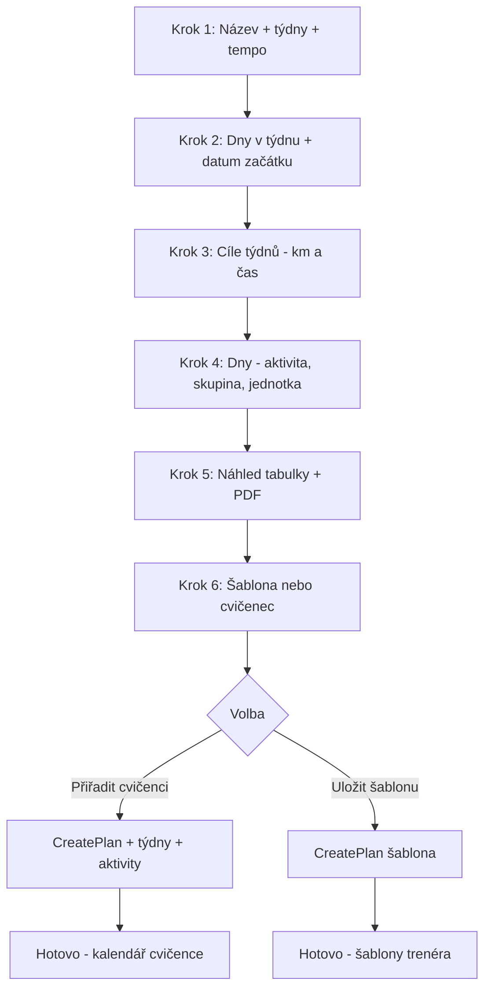

# MyTrainingSpace — Přesný popis vzhledu aplikace a tvorby tréninkového plánu

> Wireframe-popis každé obrazovky a krok za krokem průvodce tvorbou plánu.  
> Vychází z implementace v `MTS.FE/mts-fe`.

---

## Obsah

1. [Globální vzhled](#1-globální-vzhled)
2. [Přihlášení a registrace](#2-přihlášení-a-registrace)
3. [Hlavní layout (přihlášený uživatel)](#3-hlavní-layout-přihlášený-uživatel)
4. [Dashboard — Přehled](#4-dashboard--přehled)
5. [Šablony — výběr sportu](#5-šablony--výběr-sportu)
6. [Tabulka skupin a parametrů](#6-tabulka-skupin-a-parametrů)
7. [Sportovci](#7-sportovci)
8. [Kalendář](#8-kalendář)
9. [Cvičenec — Můj plán a Pokrok](#9-cvičenec--můj-plán-a-pokrok)
10. [Tvorba tréninkového plánu — kompletní průvodce](#10-tvorba-tréninkového-plánu--kompletní-průvodce)
11. [Responzivní chování](#11-responzivní-chování)

---

## 1. Globální vzhled

### Celkový dojem

Aplikace působí jako **moderní sportovní SaaS** — světlé nebo tmavé gradientní pozadí, zaoblené panely (16–20 px), jemné fialové stíny v light módu, mint akcent (`#99FFEC`) v dark módu. Přechody animací `0.2–0.3 s ease`. Font **Inter / Poppins**.

### Dva režimy

| Prvek | Light | Dark |
|-------|-------|------|
| Pozadí stránky | Šedobílý gradient | Tmavě modrý gradient (`#0F172A`) |
| Karty / panely | Bílá → `#F8FAFC` | `#1E293B` |
| Primární tlačítko | Fialový gradient `#4C1D95 → #5B21B6` | Mint `#99FFEC`, text tmavý |
| Akcent / focus | Fialová `#8B5CF6` | Mint `#99FFEC` |
| Ikony sidebaru | Šedé, hover fialová | Mint, hover bílá |

### Společné UI prvky

- **Inputy:** `border-radius: 12–24 px`, border `theme.cardBorder`, focus border akcentová barva + volitelný glow
- **Primární tlačítko:** gradient, padding `10px 30px`, `border-radius: 6–12 px`, hover posun `translateY(-1px)`
- **Sekundární tlačítko:** `variant="outlined"`, border akcentová barva
- **Karty:** `border-radius: 16 px`, `padding: 24 px`, stín `theme.cardShadow`, border `1px solid theme.cardBorder`
- **Tabulky:** uvnitř karty, hlavička `font-weight: 600`, řádky s hover pozadím
- **Snackbar:** dole uprostřed, success zelená / error červená, `border-radius: 12 px`

---

## 2. Přihlášení a registrace

**Route:** `/`, `/login`  
**Layout:** Bez navbaru a sidebaru — pouze obsah na gradientním pozadí.

```
┌────────────────────────────────────────────────────────────┐
│                                                            │
│              My Training Space                             │
│         (velký gradientní nadpis, ~5.5 rem)                │
│                                                            │
│         ┌──────────────────────────────┐                     │
│         │  ✕                    [X]  │                     │
│         │                              │                     │
│         │      Přihlášení              │                     │
│         │                              │                     │
│         │  Uživatelské jméno           │                     │
│         │  [________________________]  │                     │
│         │                              │                     │
│         │  Heslo                  👁   │                     │
│         │  [________________________]  │                     │
│         │                              │                     │
│         │      [ Přihlásit se ]        │                     │
│         │                              │                     │
│         │  Nemáte účet? Registrujte se │                   │
│         └──────────────────────────────┘                     │
│                                                            │
│  🚀 (dekorativní raketa, vlevo dole, opacity 0.8)          │
└────────────────────────────────────────────────────────────┘
```

### Přihlášení — pole

| Pole | Typ | Povinné |
|------|-----|---------|
| Uživatelské jméno | text | ano |
| Heslo | password + ikona zobrazení | ano |

### Registrace — dodatečná pole (přepínač „Registrujte se")

| Pole | Typ | Povinné |
|------|-----|---------|
| Jméno | text | ano |
| Příjmení | text | ano |
| Email | email | ano |
| Role | select: Uživatel / Trenér / Administrátor | ano |
| Pohlaví | text | ano |
| Bio | text | ne |
| Potvrzení hesla | password | ano |

**Formulář:** max šířka 600 px, vycentrovaný, karta s `backdrop-filter: blur(10px)`, `border-radius: 16 px`.

**Po přihlášení:** redirect na `/dashboard`, loading screen „Ověřování přihlášení…".

---

## 3. Hlavní layout (přihlášený uživatel)

```
padding stránky: 0 2rem
margin-top obsahu: 110px (pod navbar)

┌──────────────────────────────────────────────────────────────────┐
│ ☰  [Logo MTS]                              ☀/🌙  [Avatar ▾]   │  ← Navbar, 70px, border-radius 20px
├────┬─────────────────────────────────────────────────────────────┤
│ 📊 │                                                             │
│ 📁 │                    HLAVNÍ OBSAH                             │
│ 👥 │                  (padding 2rem)                             │
│ 📅 │                                                             │
│ ⚙  │                                                             │
│    │  Sidebar 75px                                              │
├────┴─────────────────────────────────────────────────────────────┤
│                    © MTS s.r.o. 2024                             │  ← Footer, transparentní
└──────────────────────────────────────────────────────────────────┘
```

### Navbar (přihlášený)

| Prvek | Pozice | Chování |
|-------|--------|---------|
| Ikona Menu (☰) | Vlevo | Přepne viditelnost sidebaru |
| Logo | Vedle menu | Klik → `/dashboard`, light/dark varianta |
| Přepínač tématu | Vpravo | Slunce (light) / Měsíc (dark) |
| Profil dropdown | Vpravo | Avatar emoji, odhlášení, profil |

Gradient pozadí, `border-radius: 20 px`, stín s fialovým nádechem (light).

### Sidebar

- **Šířka:** 75 px, **border-radius:** 20 px
- **Pozadí:** vertikální gradient, `backdrop-filter: blur(20px)`
- **Položky:** ikona + text při hover (tooltip vpravo)
- **Aktivní položka:** gradient `#F0F9FF → #E0F2FE` (light) nebo `#334155` (dark)
- **Dropdown „Šablony":** Skupiny, Parametry, Tréninkový plán

Ikony: react-feather (Activity, File, Users, Target, BarChart, Calendar, Settings).

### Hlavní obsah

- `margin-left: 95 px` když je sidebar viditelný (desktop)
- Obsah v `MainPage` wrapperu — centrovaný, max šířka dle stránky (typicky 1400–1600 px)

---

## 4. Dashboard — Přehled

**Route:** `/dashboard`

### Trenér

```
┌─────────────────────────────────────────────────────────────┐
│  ┌─────────────────────────┐  ┌─────────────────────────┐ │
│  │  Moje šablony           │  │  Přehled pokroků        │ │
│  │  ─────────────────────  │  │  cvičenců               │ │
│  │  [karta šablony 1]      │  │  ─────────────────────  │ │
│  │  [karta šablony 2]      │  │  [widget sportovců]     │ │
│  │  [+ nová šablona]       │  │                         │ │
│  └─────────────────────────┘  └─────────────────────────┘ │
└─────────────────────────────────────────────────────────────┘
```

- **Levá karta:** `SpaceTemplatesList` — seznam šablon plánů, klik → detail
- **Pravá karta:** `SpaceTraineesProgressWidget` — přehled pokroků cvičenců
- **Detail šablony:** `TrainingPlanDetail` s tlačítky zpět, editace, PDF export
- **Editace:** otevře `TrainingPlanWizard` od kroku 4

### Cvičenec

- **1 plán:** rovnou zobrazí `TraineeTrainingPlanView` (tabulka dnů s km, časem, poznámkou)
- **Více plánů:** seznam `TrainingPlansList`, klik → detail
- **Widget deníku:** `SpaceTrainingDiaryWidget` (na dashboardu dle implementace)

---

## 5. Šablony — výběr sportu

**Routes:** `/training-sport` (skupiny), `/parametr-sport` (parametry)

Obě stránky mají **identický vzhled** — mřížka kulatých sportovních karet.

```
                    [vycentrovaná mřížka, margin-top 5rem]

    ┌─────────┐  ┌─────────┐  ┌─────────┐  ┌─────────┐
    │  🏃     │  │  🚴     │  │  🏊     │  │  ⛷     │
    │  Běh    │  │Cyklist. │  │Plavání  │  │ Běžky   │
    └─────────┘  └─────────┘  └─────────┘  └─────────┘

    ┌─────────┐  ┌─────────┐  ┌─────────┐  ┌─────────┐
    │  🚶     │  │  🧘     │  │  ❤️     │  │  🏋️     │
    │ Chůze   │  │  Jóga   │  │SM Systém│  │ Silový  │
    └─────────┘  └─────────┘  └─────────┘  └─────────┘
```

### Karta sportu (`SpaceSportCard`)

| Vlastnost | Hodnota |
|-----------|---------|
| Rozměr | 200 × 200 px |
| Tvar | `border-radius: 16 px` (vizuálně kulatý dojem) |
| Ikona | Kruh 60 px, gradient pozadí v barvě sportu |
| Název | Pod ikonou, tučně |
| Hover | `translateY(-6px)`, stín v barvě sportu, border akcent |
| Klik | Skupiny → `/sportreport/{sport}` / Parametry → `/parametr-report/{activityId}` |

---

## 6. Tabulka skupin a parametrů

### Skupiny (`/sportreport/:sport`)

```
  běh                                    ← nadpis H4, capitalize

  ┌─────────────────────────────────────────────────────────────┐
  │ Tréninkové skupiny                              [+ přidat]  │
  ├────┬──────────────────┬─────────────────────┬────────────────┤
  │ ▼  │ Tréninková skup. │ Popis               │  ✏️  🗑️  ➕   │
  ├────┼──────────────────┼─────────────────────┼────────────────┤
  │ ▼  │ BZ               │ Běh základní        │  ✏️  🗑️  ➕   │
  │    │  ┌─ rozbalené jednotky ─────────────────────────────┐  │
  │    │  │ Pořadí │ Popis │ Jednotka │ Parametr │ Hodnota │  │  │
  │    │  │   1    │ BZ1   │ km       │ Tepy nízko│  20   │  │  │
  │    │  └──────────────────────────────────────────────────┘  │
  │ ▶  │ BR               │ Běh rychlostní      │  ✏️  🗑️  ➕   │
  └────┴──────────────────┴─────────────────────┴────────────────┘
```

- Kontejner: 90 % šířky, max 1400 px, karta s padding 24 px
- **Expand row:** šipka ▼/▶, uvnitř podřízená tabulka jednotek
- **Akce:** ikony Edit, Delete, Add (MUI)
- **Dialog přidání:** modal `SpaceTableDialog` s Formik validací

### Parametry (`/parametr-report/:activityId`)

Stejná tabulka, ale **bez expand rows**:

| Sloupec | Obsah |
|---------|-------|
| Trénink | Název parametru |
| Popis | Popis |
| Jednotka | tep/min, min/km, km/h |
| Akce | Edit, Delete, Add |

---

## 7. Sportovci

**Route:** `/trainees` (pouze trenér)

```
  ┌─────────────────────────────────────────────────────────────┐
  │ ▼ │ Jméno          │ Email              │ Počet plánů │ Akce │
  ├────┼────────────────┼────────────────────┼─────────────┼──────┤
  │ ▼  │ Jan Novák      │ cvicenec1@test.cz │      2      │ ✏️ ➕ │
  │    │  ┌─ plány sportovce ─────────────────────────────────┐ │
  │    │  │ Název plánu │ Popis │ [Enabled] │ ✏️ 🗑️ 📋 ⚡    │ │
  │    │  └───────────────────────────────────────────────────┘ │
  │ ▶  │ Marie Svobodová│ cvicenec2@test.cz │      0      │ ✏️ ➕ │
  └────┴────────────────┴────────────────────┴─────────────┴──────┘
```

**Akce u sportovce:** editace, přidat plán ze šablony, vytvořit nový plán  
**Akce u plánu:** editace, smazání, převod na šablonu, enable/disable

---

## 8. Kalendář

**Route:** `/calendar`

- Komponenta `react-big-calendar` na celou šířku obsahu
- **Trenér:** vidí plány svých cvičenců (výběr cvičence)
- **Cvičenec:** vidí vlastní plán
- Tréninky rozložené od `dateTimeStart` podle dnů v plánu
- **Klik na trénink:** dialog pro poznámku do tréninkového deníku
- Barvy kalendáře přizpůsobené theme (vlastní CSS v GlobalStyles)

---

## 9. Cvičenec — Můj plán a Pokrok

### Můj plán (`/my-training-plan`)

Stejný pohled jako `TraineeTrainingPlanView` na dashboardu — tabulka:

| Den | Pohybová aktivita | Čas | Km | Provedeno | Poznámka |

+ tlačítko PDF export.

### Pokrok (`/my-progress`)

```
  Můj pokrok
  Sledujte svůj vývoj a dosažené cíle, {jméno}!

  ┌──────────┐ ┌──────────┐ ┌──────────┐ ┌──────────┐
  │ 📈 78%   │ │ 🎯 3/4   │ │ 📅 12    │ │ 🏆 5     │
  │ Celkový  │ │ Tento    │ │ Dní v    │ │ Úspěchy  │
  │ pokrok   │ │ týden    │ │ řadě     │ │          │
  └──────────┘ └──────────┘ └──────────┘ └──────────┘

  Detailní statistiky a grafy (coming soon…)
```

> **Poznámka:** Hodnoty jsou zatím mock — v novém projektu napojit na reálná data.

---

## 10. Tvorba tréninkového plánu — kompletní průvodce

**Route:** `/training-plan`  
**Komponenta:** `TrainingPlanWizard`  
**Počet kroků:** **6** (ne 5)

### Obal průvodce

Všechny kroky jsou uvnitř **jedné velké karty**:

```
┌──────────────────────────────────────────────────────────────┐
│  max-width: 1400px, margin: auto, padding: 16px             │
│  ┌────────────────────────────────────────────────────────┐  │
│  │  KARTA (cardBackground, border-radius: 12px, padding 24px) │
│  │                                                        │  │
│  │  [záložky týdnů — pouze krok 3 a 4, desktop]          │  │
│  │                                                        │  │
│  │  ═══════════════ OBSAH KROKU ═══════════════          │  │
│  │                                                        │  │
│  └────────────────────────────────────────────────────────┘  │
└──────────────────────────────────────────────────────────────┘
```

**Záložky týdnů** (`SpaceWeekTabs`) — zobrazí se od kroku 3:
- Nadpis: „Cíle jednotlivých týdnů" (krok 3) nebo „Detailní plán tréninkových dnů" (krok 4)
- Záložky: `Týden 1 | Týden 2 | Týden 3 | …`
- Aktivní záložka: fialový spodní border `#8B5CF6`, tučný text

---

### KROK 1 — Název a délka plánu

**Komponenta:** `SpaceTrainingPlanDuration`

```
        Zadejte název a délku tréninkového plánu:

        Název plánu
        [____________________________________]

        Počet týdnů
        [____________________________________]

        Nastavení tempa (min/km):

        Minuty na kilometr
        [  5  ]                    ← výchozí 5

        Výchozí tempo: 5 min/km. Čas se automaticky vypočítá
        v minutách na základě kilometrů a zvoleného tempa.

                    [ Další ]
```

| Pole | Typ | Výchozí | Validace |
|------|-----|---------|----------|
| Název plánu | text | prázdné | povinné |
| Počet týdnů | number | prázdné | > 0, povinné |
| Minuty na kilometr | number | 5 | použito pro auto-výpočet času |

**Co se uloží do stavu:**
- `planTitle` = název
- `duration` = počet týdnů (= `numberOfCycles` při ukládání)
- `paceMinutes` = tempo pro výpočet času z km

**Tlačítko Další** → krok 2

---

### KROK 2 — Výběr tréninkových dnů

**Komponenta:** `SpaceTrainingDaySelect`

```
        Vyberte dny v týdnu pro tréninky:

        Datum začátku tréninkového plánu
        [ 2026-06-09 ]          ← date picker, výchozí = dnes
        Datum prvního dne tréninkového plánu

        ☑ Pondělí    ☑ Úterý     ☐ Středa
        ☑ Čtvrtek    ☐ Pátek     ☐ Sobota
        ☐ Neděle

              [ Zpět ]    [ Další ]
```

| Pole | Validace |
|------|----------|
| Datum začátku | povinné, type `date` |
| Dny v týdnu | alespoň 1 checkbox |

**Co se stane po „Další":**
1. Uloží se `dateTimeStart`
2. Vygeneruje se struktura `weeks[]`:
   - Pro každý týden (1…N) se vytvoří dny podle zaškrtnutých dnů v týdnu
   - Každý den dostane vypočtené `date` od data začátku
   - Prázdné hodnoty: `activity`, `category`, `unit`, `expectedKm: 0`, `expectedTime: ''`

**Příklad:** 4 týdny, Po+St+Pá → 12 dní celkem (3 dny × 4 týdny)

**Tlačítko Zpět** → krok 1

---

### KROK 3 — Cíle jednotlivých týdnů

**Komponenta:** `SpaceTrainingWeekEditor`  
**Záložky:** aktivní týden (desktop) / všechny týdny pod sebou (mobil)

```
  Cíle jednotlivých týdnů
  ──────── Týden 1 ─── Týden 2 ─── Týden 3 ─── Týden 4 ─────

  ┌─────────────────────────────────────────────────────────┐
  │  Týden 1                                                │
  │                                                         │
  │  Poznámka k týdnu                                      │
  │  [____________________________________________]         │
  │  (multiline, 2 řádky)                                  │
  │                                                         │
  │  Odhad km v týdnu                                      │
  │  [  20  ]                                              │
  │                                                         │
  │  Odhadovaný čas v týdnu (minuty)                       │
  │  [  100  ]          ← auto z km × tempo, lze přepsat   │
  │                                                         │
  └─────────────────────────────────────────────────────────┘

                    [ Další ]
```

| Pole per týden | Popis |
|----------------|-------|
| Poznámka k týdnu | volitelný text |
| Odhad km v týdnu | number, **povinné** |
| Odhadovaný čas | minuty nebo hh:mm, **povinné**, auto z km |

**Auto-výpočet:** změna km → čas = `ceil(km × paceMinutes)` minut

**Validace před Další:** všechny týdny musí mít vyplněné km i čas, jinak alert.

**Tlačítko Další** → krok 4

---

### KROK 4 — Detailní plán tréninkových dnů

**Komponenta:** `SpaceTrainingDayEditor`  
**Záložky:** aktivní týden (desktop)

```
  Detailní plán tréninkových dnů
  ──────── Týden 1 ─── Týden 2 ─── ...

  ┌─────────────────────────────────────────────────────────┐
  │  Týden 1                                                │
  │  Celkem km: 20 km   Celkem čas: 01:40                   │
  │  Zbývá km: 5 km      Zbývá čas: 00:25    ← červeně pokud záporné │
  │                                                         │
  │  Dny v týdnu                                    [+]     │
  │                                                         │
  │  ▼ pondělí 9. 6.                          Běhání    🗑  │
  │  ┌─────────────────────────────────────────────────┐   │
  │  │  Aktivita        [ Běhání          ▾ ]          │   │
  │  │  Skupina tréninků [ BZ             ▾ ]          │   │
  │  │  Tréninková jedn. [ BZ1            ▾ ]          │   │
  │  │  Km              [ 20 ]  ← auto z jednotky      │   │
  │  │  Čas             [ 01:40 ] ← auto z jednotky    │   │
  │  │  Poznámka        [________________]             │   │
  │  └─────────────────────────────────────────────────┘   │
  │                                                         │
  │  ▶ středa 11. 6.                                        │
  │  ▶ pátek 13. 6.                                         │
  └─────────────────────────────────────────────────────────┘

                    [ Další ]
```

#### Accordion den (rozbalený)

| Pole | Typ | Chování |
|------|-----|---------|
| Aktivita | select | Načte sporty z API; změna resetuje skupinu a jednotku |
| Skupina tréninků | select | Načte skupiny pro vybraný sport (BZ, BR…) |
| Tréninková jednotka | select | Načte jednotky pro skupinu (BZ1, BZ2…) |
| Km | number | Auto z parametrů jednotky po výběru |
| Čas | text hh:mm | Auto z parametrů jednotky; lze přepsat |
| Poznámka | text | volitelná |

#### Statistiky týdne (horní řádek)

- **Celkem km / čas:** součet z dnů vs. cíl z kroku 3
- **Zbývá km / čas:** rozdíl; záporné hodnoty **červeně** (`#ff4444`)

#### Akce

- **[+]** vpravo nahoře: přidá nový den do týdne (datum = poslední den + 1)
- **🗑** u dne: smaže den z týdne

**Kaskáda selectů:**
```
Aktivita (sport) → Skupina → Jednotka → auto km + čas z API
```

**Tlačítko Další** → krok 5

---

### KROK 5 — Náhled a finální úpravy tabulky

**Komponenta:** `SpaceTrainingWeekTable`

Kompletní tabulka celého plánu — poslední kontrola před uložením.

```
  Tréninkový plán pro běh                    [ Export PDF ]

  ┌──────┬─────────┬──────────┬──────────┬────────┬────┬──────┬──────┐
  │ Týden│   Den   │ Aktivita │ Kategorie│ Jednotka│ Km │ Čas  │ Akce │
  ├──────┼─────────┼──────────┼──────────┼────────┼────┼──────┼──────┤
  │  1   │ po 9.6. │ Běhání   │ BZ       │ BZ1    │ 20 │ 1:40 │  🗑  │
  │      │ st 11.6.│ Běhání   │ BZ       │ BZ2    │ 30 │ 2:30 │  🗑  │
  │  2   │ po 16.6.│ Běhání   │ BZ       │ BZ3    │ 20 │ 1:40 │  🗑  │
  └──────┴─────────┴──────────┴──────────┴────────┴────┴──────┴──────┘

  (na mobilu: accordion místo tabulky)

                    [ Další ]
```

- Editovatelná pole přímo v tabulce (aktivita, skupina, jednotka, km, čas)
- Poznámka k týdnu editovatelná v buňce týdne
- **Export PDF:** html2canvas → jspdf
- **Tlačítko Další** → krok 6

---

### KROK 6 — Dokončení a uložení

**Komponenta:** `SpaceTrainingPlanFinalStep`

```
        Dokončení tréninkového plánu

        ☑ Uložit jako šablonu
        ☑ Přiřadit cvičenci        ← výchozí zaškrtnuto

        Cvičenec
        [ Jan Novák (cvicenec1)  ▾ ]

        [ Zpět ]  [ 💾 Uložit jako šablonu ]  [ Dokončit plán ]
```

| Možnost | Popis |
|---------|-------|
| Uložit jako šablonu | Uloží do `training_plans` (šablona trenéra) |
| Přiřadit cvičenci | Uloží do `training_plan_user_assigns` pro vybraného cvičence |

**Validace:**
- Při přiřazení: musí být vybrán cvičenec
- Alespoň jedna z možností musí být zaškrtnuta

**Tři tlačítka:**
1. **Zpět** → krok 5
2. **💾 Uložit jako šablonu** — rychlá akce (zaškrtne jen šablonu, uloží)
3. **Dokončit plán** — uloží dle zaškrtnutých checkboxů

---

### Co se stane po „Dokončit plán" — technický flow ukládání

#### Varianta A: Přiřadit cvičenci

Sekvenční volání API (v novém projektu ideálně jedna transakce/RPC):

```
1. POST CreatePlan
   Body: {
     Name, Description,           // Description = poznámky týdnů spojené " | "
     CycleLength,                  // = počet tréninkových dnů v týdnu (ne 7!)
     NumberOfCycles,               // = počet týdnů
     Enable: true,
     UserId,                       // ID cvičence
     DateTimeStart                 // ISO datum z kroku 2
   }
   → vrátí planId

2. Pro každý týden (1…N):
   POST CreateWeekDefinitionsForPlan
   Body: {
     IdTrainingPlan: planId,
     WeekOrder,                    // 1, 2, 3…
     WeekName,                     // "Týden 1" nebo vlastní
     WeekDescription,              // poznámka týdne
     WeekKilometers,               // km z kroku 3
     WeekTimeHours                 // čas převedený na hodiny (zaokrouhleno)
   }

3. Pro každý den s vyplněnou aktivitou + skupinou + jednotkou:
   POST CreateActivityForPlan
   Body: {
     IdTrainingPlan: planId,
     IdActivityTraining: unitId,   // ID jednotky (BZ1, BR2…)
     AutonumCycle: weekNumber,      // číslo týdne (1-based)
     AutonumInCycle: dayNumber,     // pořadí dne v týdnu (1-based)
     Name: unitName,               // název jednotky
     Description: dayNote,
     OrderInCycle: 1
   }
```

> Km a čas se **neukládají** do DB u aktivity — načítají se z parametrů jednotky (`ActivityTrainingParametersAssigns`).

#### Varianta B: Uložit jako šablonu

```
POST TrainingPlan/CreatePlan (šablony endpoint)
Body: {
  Name, Description, CycleLength, NumberOfCycles, Enable: true
}
→ (+ volitelně week definitions a activities stejným způsobem)
```

#### Po úspěšném uložení

- Alert: „Tréninkový plán byl úspěšně vytvořen…"
- Reset wizardu na krok 1
- Nebo návrat přes `onBack` callback (při editaci z dashboardu)

---

### Editace existujícího plánu

- Wizard startuje na **kroku 4** (`step = 4`)
- Načte kompletní plán přes `GET GetPlanCompleet/{id}`
- Předvyplní týdny, dny, aktivity, km, čas
- Tlačítko „← Zpět na detail" nahoře v kartě
- Update plánu: **TODO** ve zdrojovém projektu (zatím jen alert)

---

### Diagram toku průvodce



---

### Příklad kompletního plánu (seed)

| Vlastnost | Hodnota |
|-----------|---------|
| Název | Tréninkový plán pro běh |
| Týdny | 4 |
| Dny | Po, St, Pá (příklad) |
| Týden 1 | 20 km, BZ1 (po), BZ2 (st) |
| Týden 2 | 30 km, BZ3 (po) |
| Jednotky | BZ1=20km, BZ2=30km, BZ3=20km |

---

## 11. Responzivní chování

| Breakpoint | Chování |
|------------|---------|
| **> 900 px** | Sidebar vlevo, záložky týdnů ve wizardu, jeden týden na obrazovku |
| **≤ 900 px** | Wizard: všechny týdny pod sebou, bez záložek |
| **≤ 768 px** | Sidebar přesune **dolů** (bottom bar), obsah `padding-bottom: 80px` |
| **≤ 600 px** | Login formulář na 98 vw, menší nadpis |

### Loading stavy

| Místo | Text |
|-------|------|
| Start aplikace | „Ověřování přihlášení…" |
| Načítání plánu ve wizardu | spinner / `loadingPlan` |
| Načítání aktivit | „Načítání aktivit…" |
| Tabulky | „Načítání…" |
| Dashboard cvičence | „Načítání tréninkových plánů…" |

---

## Shrnutí — co musí nový projekt zachovat

1. **6krokový wizard** s kartou, záložkami týdnů a kaskádou selectů
2. **Auto-výpočet času** z km × tempo (kroky 1, 3, 4, 5)
3. **Statistiky zbývajících km/čas** v kroku 4 (červeně při překročení)
4. **Dva režimy uložení:** šablona vs. přiřazený plán cvičenci
5. **Sportovní karty** 200×200 s barevnými ikonami
6. **Univerzální tabulka** s expand rows pro skupiny/jednotky
7. **Layout:** navbar + úzký sidebar + footer, gradient pozadí
8. **Role-based menu:** trenér vidí Šablony a Sportovce, cvičenec Můj plán a Pokrok

---

*Dokument vytvořen: červen 2026*  
*Zdroj: `TrainingPlanWizzard.tsx`, `SpaceTrainingPlanDuration.tsx`, `SpaceTrainingDaySelect.tsx`, `SpaceTrainingWeekEditor.tsx`, `SpaceTrainingDayEditor.tsx`, `SpaceTrainingWeekTable.tsx`, `SpaceTrainingPlanFinalStep.tsx`, `App.tsx`*
